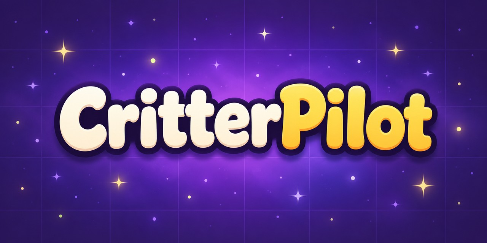

  

<b>The free PC tool that helps you clear the Clash of Critters Campaign.</b>

  
  
  
  

CritterPilot runs on your PC next to BlueStacks. It picks a team that has already won your stage, places it for you and plays the Campaign stage after stage, while you do something else.

## What it helps with

| | |
|---|---|
| **Campaign** | Available now |
| **Dojo** | Coming soon |
| **Boss Challenge** | Coming soon |
| **PvE events** | Coming soon, one at a time |

## Get started

1. Join the [CritterPilot Discord](https://discord.gg/VsUxtMRavb).
2. In **#how-to-install**, press **Get your free key**.
3. Follow the guide in the same channel to download, install and start.

You need a Windows PC with BlueStacks. The Mac version is on its way.

## Playing fair

CritterPilot is PvE only: it plays the Campaign against the game and never raids, duels or attacks another player. It never buys anything or taps a paid offer. It runs only on your computer, and one click stops it whenever you want to take over.

## Questions

**Will I get banned?**

No. CritterPilot is built so your account doesn't get banned. Like every third-party tool, it isn't allowed by the game's terms, and we'd rather tell you than hide it.

**Why does Windows show a warning when I install it?**

The app isn't signed with a paid Microsoft certificate, so SmartScreen asks you to confirm. Every release comes with its SHA-256 fingerprint, so you can check the file is ours.

**Does it work on Mac?**

The Mac version is coming soon. Join the Discord to hear first when it's out.

**Where do I get help?**

On the Discord. Questions and bug reports get answered by us and by other players.

## Join us

Everything else is on the Discord: your free key, every new version announced first, news when the game updates, and help when you need it.

<a href="https://discord.gg/VsUxtMRavb"><b>Join the CritterPilot Discord</b></a>

---

Clash of Critters and its images are trademarks of Farlight Games. CritterPilot is an unofficial tool, not affiliated with or endorsed by Farlight Games. This repository contains no source code.
